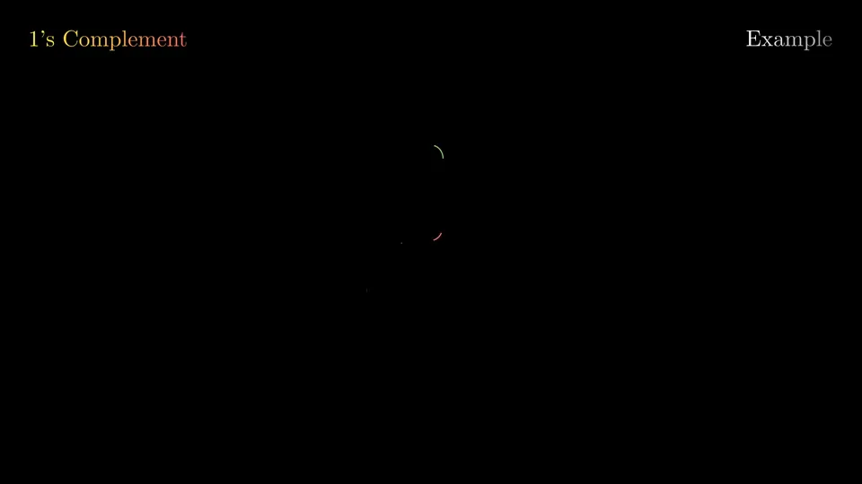
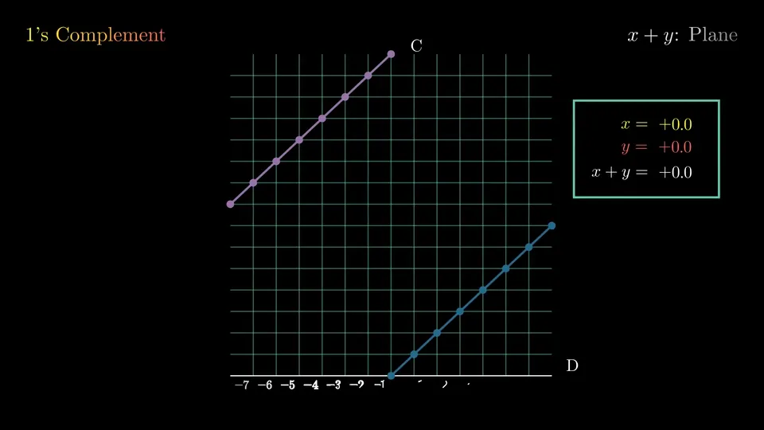
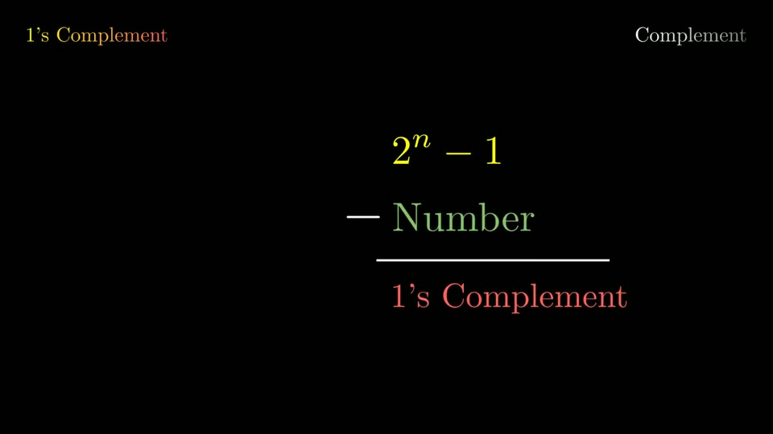
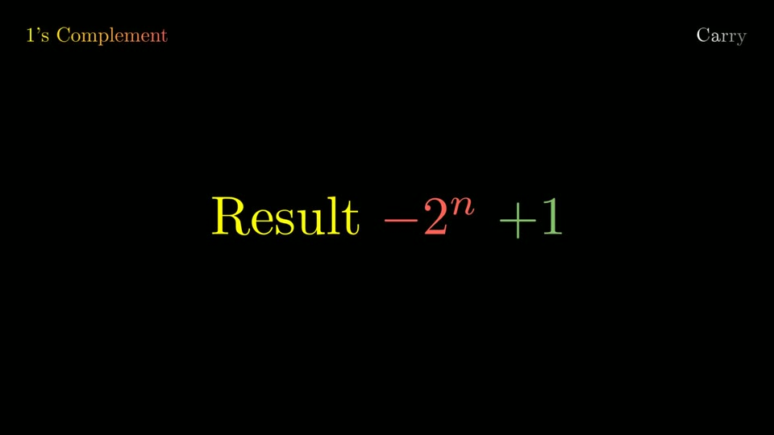
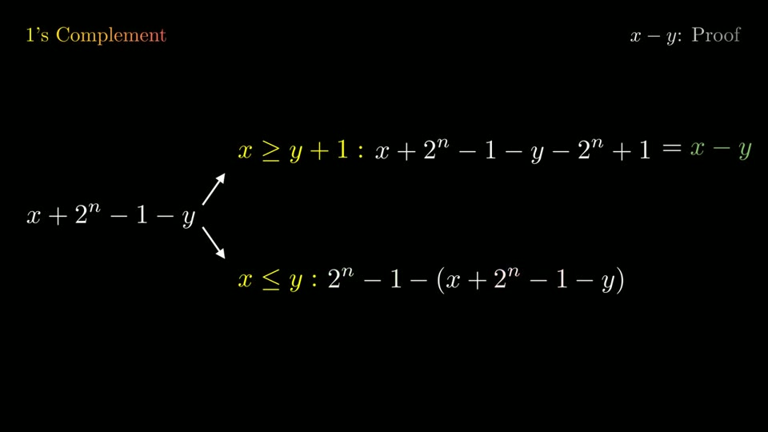

<div align="center">

# 1's Complement

**Why the carry goes back in.** An animated presentation, made with Manim.

[**Step through the slides**](https://ausdavoud.github.io/1s-Complement-Manim/slides.html)&nbsp;&nbsp;·&nbsp;&nbsp;[Watch it as one video](https://ausdavoud.github.io/1s-Complement-Manim/1s-complement.mp4)&nbsp;&nbsp;·&nbsp;&nbsp;[Website](https://ausdavoud.github.io/1s-Complement-Manim/)

<br>



</div>

Add two numbers in 1's complement and sometimes a 1 falls off the left end. Instead of throwing it away, you add it back to the result. These slides show why that gives the right answer.

## What it covers

1. **An example.** 5 + (−3) in 4 bits gives `1 0001`. Adding the stray 1 back gives `0010`, which is 2.
2. **Two rules.** The complement of a number is 2ⁿ − 1 − the number, and adding the carry back is the same as subtracting 2ⁿ and adding 1.
3. **The plane.** The values are laid out on a plane to show when a sum overflows.
4. **Every case, proved.** x + y, x − y and −x − y.

<p align="center">
  
</p>

<p align="center">
  
  
  
</p>

## Run it yourself

You'll need [uv](https://docs.astral.sh/uv/), a LaTeX distribution, and the Cairo and Pango libraries Manim draws with ([Manim's installation guide](https://docs.manim.community/en/stable/installation.html) covers both).

```bash
uv sync
uv run ./render.sh
```

Then open `slides.html` and move through it with the arrow keys. For a quick low-quality pass, run `MANIM_FLAGS=-ql uv run ./render.sh`.

## Publishing the website

```bash
uv run ./publish.sh
```

This renders every scene, builds the site from `web/`, and pushes the result to the `gh-pages` branch, which GitHub Pages serves. Rendered videos never go into `main`, and only the files that changed get uploaded.

## License

[MIT](LICENSE)
